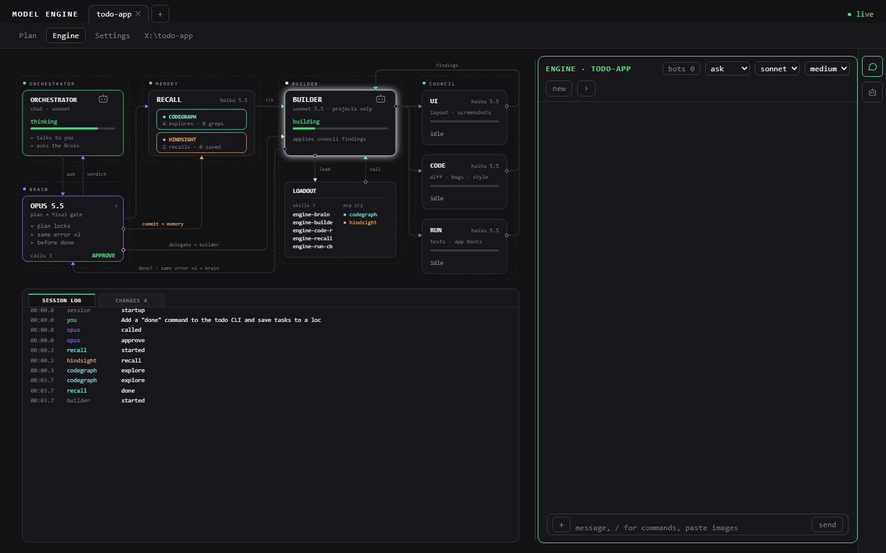
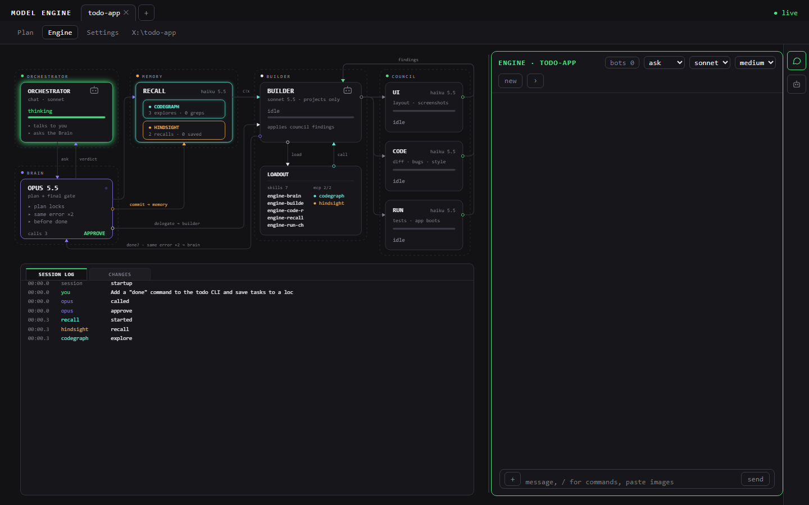
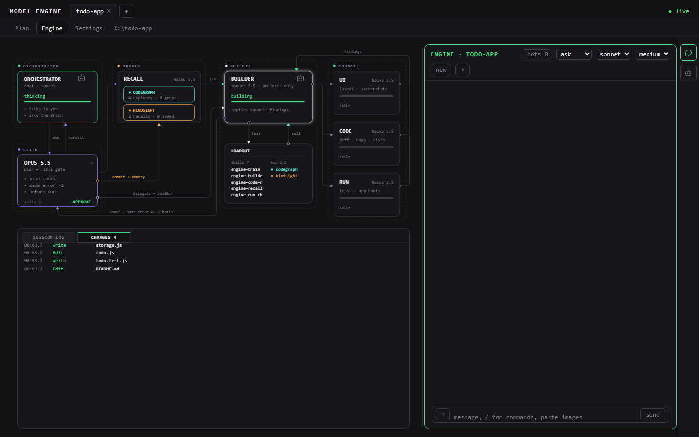
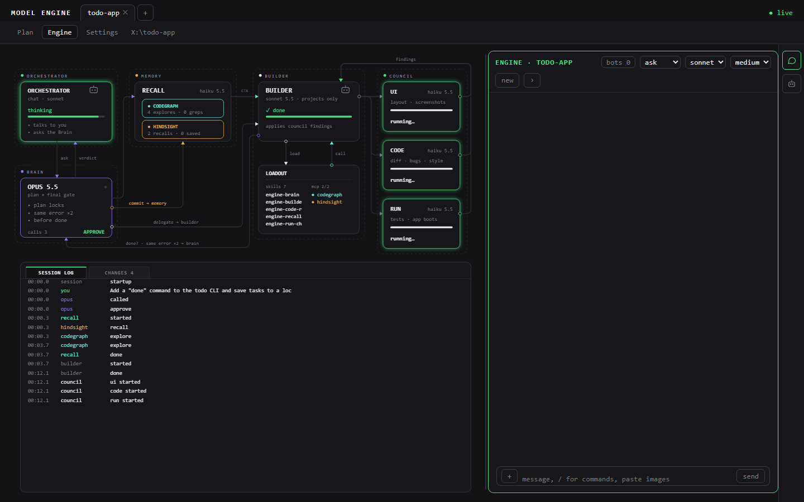
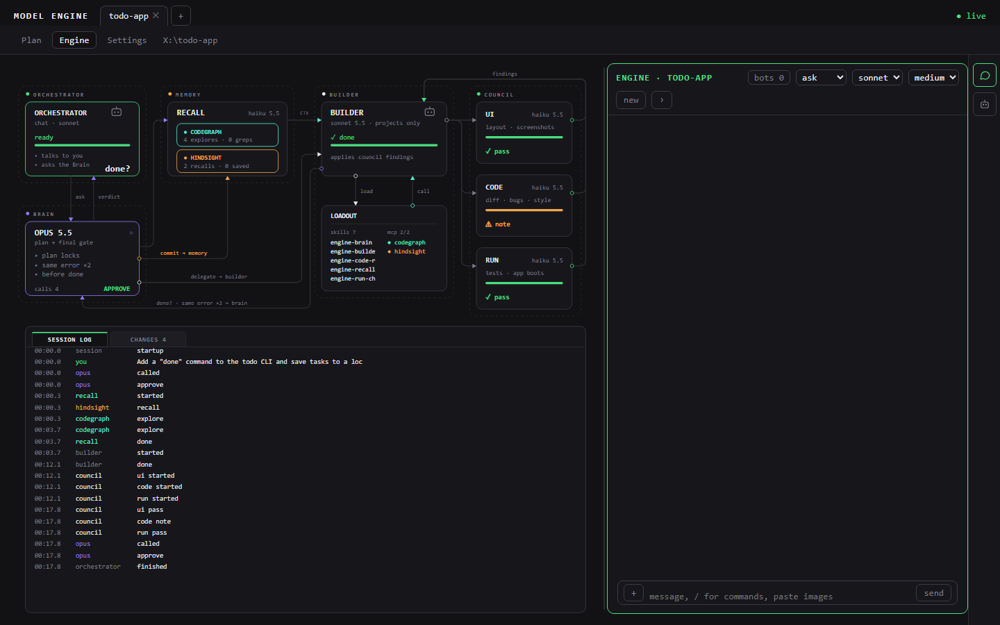
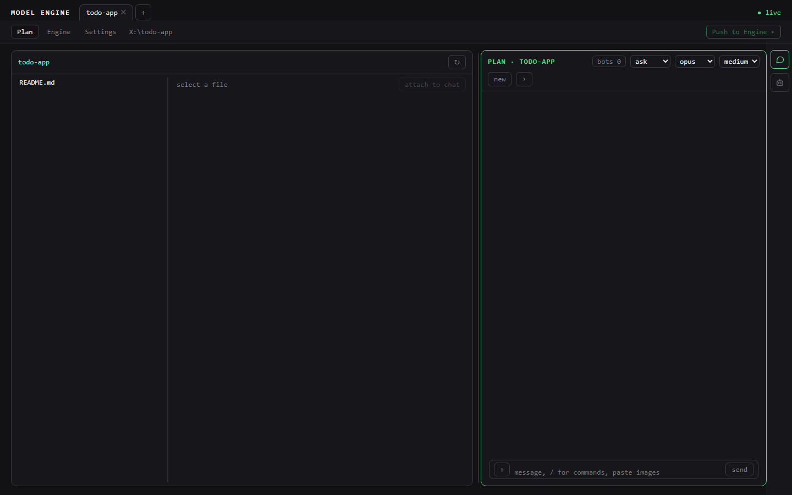
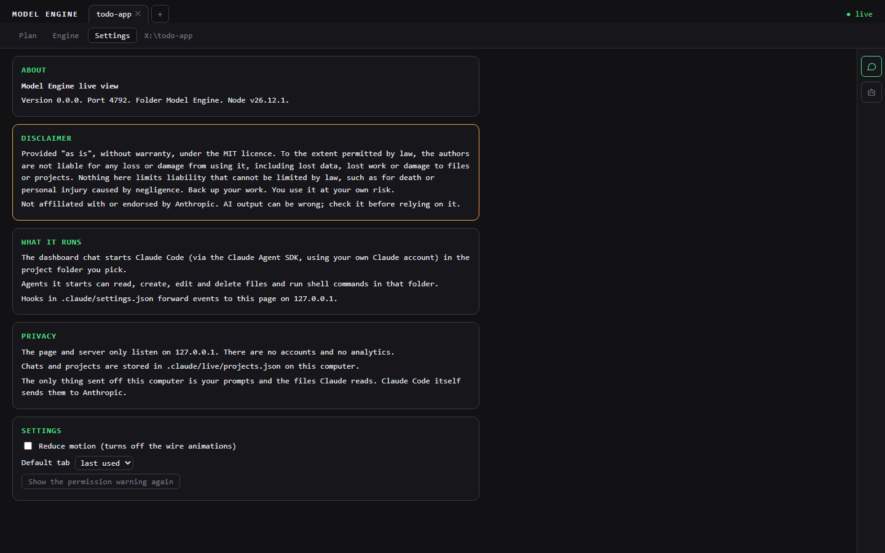

<h1 align="center">Model Engine</h1>

<p align="center">
  <strong>A team of Claude Code agents with a live dashboard that shows who is doing what.</strong><br>
  One session plans and talks to you, a builder edits the files, a three-member council reviews, and an Opus reviewer signs off.<br>
  Everything runs on your computer. No account, no analytics.
</p>

<p align="center">
  <a href="LICENSE"></a>
  
  
</p>

<p align="center">
  <a href="#quick-start">Quick start</a> ·
  <a href="#using-model-engine">Using it</a> ·
  <a href="#why-model-engine">Why</a> ·
  <a href="#features">Features</a> ·
  <a href="#screenshots">Screenshots</a> ·
  <a href="#what-model-engine-runs-on-your-machine">What it runs</a> ·
  <a href="#privacy">Privacy</a> ·
  <a href="#development">Development</a>
</p>

<p align="center">
  
</p>

---

Model Engine is a set of Claude Code agents, skills and hooks, plus a small local web page that shows them working. **Drop the `.claude` folder into a project, start the dashboard, and watch each step of a build move through plan, recall, build, review and sign-off.** The agents are real Claude Code subagents, run with your own Claude Code account.

## Quick start

You need [Claude Code](https://code.claude.com) and Node.js 18.14 or newer (the minimum for the Claude Agent SDK that the dashboard chat uses). The `--open` flag starts Microsoft Edge, so it is Windows only. The server itself is plain Node and the URL works in any browser.

```bash
git clone https://github.com/doolecg/Model-Engine.git
cd Model-Engine
npm install --prefix .claude/live
node .claude/live/server.js --open
```

Without `--open`, start the server and visit http://127.0.0.1:4777.

The dashboard has its own chat, which sets everything up for you. To watch a normal terminal session instead, set `MODEL_ENGINE_LIVE=1` before starting Claude Code in the project folder:

```powershell
$env:MODEL_ENGINE_LIVE = "1"; claude
```

Without that variable the hooks do nothing, so other tools that open this folder stay out of the dashboard. To use the agents in your own project, copy the `.claude` folder into it and merge `CLAUDE.md` with your own.

## Portable install and updates

No installer: the folder is the install.

1. Download the release zip or tarball from [GitHub Releases](https://github.com/doolecg/Model-Engine/releases), or clone the repo. Unzip it anywhere.
2. Run `Model-Engine.cmd` (Windows) or `./model-engine.sh` (Linux and macOS; run `chmod +x model-engine.sh` once if the executable bit was lost). Both need Node.js on your PATH. On the first run they fetch the dependencies with `npm ci`, nothing else is downloaded.

**Updates.** Settings has an Updates card. Pick a channel: **Stable** is the latest GitHub Release, **Dev** is the tip of the `dev` branch. It checks about once a day (turn that off if you like) and tells you when something newer exists. **Update now** shows what will change, downloads it, checks it, swaps the files and restarts the server. Installing automatically is off by default; if you turn it on, the app runs code downloaded from GitHub without asking.

- **Replaced:** `.claude/` (except `.claude/live/projects.json` and `.claude/live/node_modules`), `CLAUDE.md`, `README.md`, `LICENSE`, the launcher scripts, `Dockerfile`, `docker-compose.yml` and `docs/`. Local edits to files in `.claude/` and `docs/` are replaced; the previous version is kept for rollback.
- **Kept:** `projects.json`, `.env`, `workspace/`, `node_modules` and the `.update/` folder.
- **Safety:** the archive is unpacked into `.update/tmp` and refused if it holds `..` or absolute paths, links, device files or too much data. `node --check` must pass on the new `server.js` and `updater.js` before anything is touched. Dependencies are reinstalled with `npm ci` only if the lockfile changed. Any failure restores the old files.
- **Backup and rollback:** the replaced files are copied to `.update/backup/<version>` (only the latest backup is kept). **Roll back** in Settings puts them back.
- **Network:** it contacts only `api.github.com` and `codeload.github.com` over HTTPS, sends no data about you, your projects or your machine, and can be turned off in Settings.
- **Not available** in Docker (rebuild the image instead) or in a git checkout (use `git pull`). It also waits while a run is active.

## Run it in Docker

```bash
docker compose up --build
```

Then open http://127.0.0.1:4777. The container publishes the port on your own computer only.

1. Copy `.env.example` to `.env` next to `docker-compose.yml` and set either `CLAUDE_CODE_OAUTH_TOKEN` (your Claude subscription, see [Use your Claude subscription](#use-your-claude-subscription)) or `ANTHROPIC_API_KEY`. A Claude login on the host does not carry into the container. The agents in the container have shell access to `/workspace` and can read these values, so only use them on a machine you trust.
2. Set `WORKSPACE` (in the same `.env` file or your shell) to the folder the agents may edit. They can only touch that folder and the container. The default is `./workspace`.
3. The dashboard's project list lives in the Docker volume `engine-data`, mounted at `/data`.
4. Stop it with `docker compose down`. Add `-v` to delete the volume as well.

## Use your Claude subscription

The dashboard chat can run on your Claude subscription instead of an API key. This is for personal use on your own machine, with your own login; Anthropic's current terms apply, so check them before relying on it.

- Portable folder or terminal runs: nothing to set up. If you are signed in to `claude`, the chat uses that login.
- Docker: run `claude setup-token` on your PC, then put the token in `.env` as `CLAUDE_CODE_OAUTH_TOKEN=...`. The agents in the container can read it, so only do this on a machine you trust.
- Switch between the subscription and an API key in Settings, Accounts, Claude sign-in. It takes effect on the next run. In subscription mode an `ANTHROPIC_API_KEY` in the environment is ignored, so it cannot silently bill per token.

## Using Model Engine

This is the user guide. It takes about five minutes to read.

### First run

1. Start the server: `node .claude/live/server.js --open` (see [Quick start](#quick-start)), or run the launcher from the [portable install](#portable-install-and-updates).
2. Open http://127.0.0.1:4777 if `--open` did not do it for you. The header shows "offline" until the page connects.
3. Add a project (next section).

The header has four tabs:

- **Plan.** A file explorer for the project and a chat with the Brain. You plan here.
- **Engine.** The animated diagram, the session log and the Changes list. You build here.
- **Usage.** Totals of the usage the dashboard has recorded, split by provider, by day and by model.
- **Settings.** Version, updates, remote access, accounts, on-demand tools and display options.

The chat sits in a panel on the right. The "bots" button in its header opens a panel that lists the subagents that have run.

### Add a project

1. Press the **+** button next to the project tabs in the header.
2. Pick a folder. You can type a path and press Enter, use the quick links, click through the folder list, or type a name and press "create" to make a new folder.
3. On Windows, outside Docker, there is also a **Browse with Windows...** button. It opens the normal Windows folder dialog.
4. Press **Use folder**. The project gets its own tab.

In Docker the folder browser only shows the workspace folder, and the Windows button is hidden. See [Run it in Docker](#run-it-in-docker).

### Plan, then build

1. On the Plan tab, tell the Brain what you want. It interviews you and writes `PLAN.md` in the project folder. In this chat it may only write `PLAN.md` and files under `docs/`. It plans and does not build.
2. When `PLAN.md` exists, **Push to Engine** becomes active. Press it. The dashboard switches to the Engine tab, attaches `PLAN.md` and fills the message box with a build instruction.
3. Press **send** in the Engine chat. The orchestrator then works through the plan one step at a time: recall, build, council, reviewer.

### Reading the Engine view

- **Diagram.** One box for each agent. A box lights up when a hook reports that agent working. A dotted border that moves means that part is working now.
- **Session log.** The first tab of the log panel lists what each agent did, with the time.
- **Changes.** The second tab shows each file edit as it happens. Click a change to open its diff. In the diff, lines that start with `+` were added and lines that start with `-` were removed. Press Esc or "Close" to leave it.
- **One log for each project.** Each project tab keeps its own session log and changes.

### Steering a run

Press **Status?** in the chat header while the agent is working. It sends this request without stopping the run: reply in at most four short lines with what you are doing now, what is done, what is blocked or needs me, and what is next. The reply appears in the chat. Use **stop** to interrupt a run.

### Seats and tools

- **Orchestrator.** Your main session. It talks to you and coordinates, and does not edit files.
- **Brain (Opus reviewer).** Checks the plan before it locks and the final diff before "done". It answers approve or reject.
- **Recall (Haiku).** Searches memory, then code. Read-only.
- **Builder (Sonnet).** Edits the files, one task card at a time.
- **Council (Haiku).** UI and code read the diff. Run executes the tests and starts the app.

On-demand tools, such as [Frugal Blender](#on-demand-tools), are off until you tick them under Settings > On-demand tools. After that, only the Brain can switch one on, and only when the plan needs it.

The UI and run council members use the Playwright MCP to look at the running app. It is optional and you install it yourself. Without it they read the diff and run tests.

### Settings tour

- **Updates.** Pick a channel, check now, update now, roll back. Details are in [Portable install and updates](#portable-install-and-updates).
- **Remote access (Tailscale).** Off by default. Setup and the safety rules are in [Remote access over Tailscale](#remote-access-over-tailscale).
- **Accounts.** Shows which CLIs are installed and whether a login, subscription token or API key exists, and lets you choose between your Claude subscription and an API key for the chat. It only checks that the files or environment variables exist. It never reads them.
- **On-demand tools.** The switches described above.
- **Reduce motion.** Turns off the animated wires. The page also follows your system setting.
- **Default tab.** Choose Plan, Engine or Settings, or keep the last tab you used.
- **Show the permission warning again.** Brings back the warning you see before switching to a mode that stops asking.

### Ways to run it

- Portable folder, with the launcher and the updater: [Portable install and updates](#portable-install-and-updates).
- Docker: [Run it in Docker](#run-it-in-docker).
- From your phone or another computer: [Remote access over Tailscale](#remote-access-over-tailscale).

### Troubleshooting

- **Port 4777 is already in use.** An old server is still running. Stop it by its process ID (the server prints it when it starts), or start the new one on another port with `MODEL_ENGINE_PORT`. The hook uses the same variable.
- **The chat does not work in Docker.** Put `CLAUDE_CODE_OAUTH_TOKEN=...` (from `claude setup-token`) or `ANTHROPIC_API_KEY=...` in the `.env` file next to `docker-compose.yml`. A login on the host does not reach the container.
- **The diagram stays quiet while I work in a terminal.** Hooks only report when `MODEL_ENGINE_LIVE=1` is set, or when you use the dashboard chat, which sets it for you.
- **There is no Windows folder button in Docker.** That is expected. Use the built-in browser, which shows the workspace folder.
- **The updater refuses.** It does not run in Docker (rebuild the image) or in a git checkout (use `git pull`). It also waits while a run is active.
- **A diff shows "No diff recorded for this change".** The hook reported the edit without a diff. The file name and time are still shown.

## Why Model Engine

A long agent session is hard to follow. You see a stream of tool calls and have to guess which model did what and whether anyone checked it.

Here each job has an owner. The orchestrator (your main session) talks to you and never edits project files. Only the builder edits. Searches go to a read-only recall agent. Before anything is called done, three cheap reviewers check the change and an Opus reviewer says approve or reject. The dashboard draws this as it happens, so you can see where a build is and who is holding it up.

## Features

The roles, as set in `CLAUDE.md` and `.claude/agents`:

- **Orchestrator.** The main session. It talks to you and coordinates, and does not edit project files.
- **Reviewer (Opus).** Checks the plan before it locks, checks the final diff before "done", and answers approve or reject. After an approve it writes a handoff note to memory, and after the same error twice a lesson.
- **Recall (Haiku).** Read-only lookup. It searches memory (Hindsight) first, then code (codegraph).
- **Builder (Sonnet).** The only agent that edits files. It takes one short task card at a time and runs its own check.
- **Council (Haiku).** Three members: UI, code and run. UI and code read the diff. Run executes the tests and starts the app. Each replies pass, note or fail.

Also: choose a project folder with the Windows folder browser (not in Docker).

### On-demand tools

Frugal Blender is an optional MCP server (named `blender`) that you install yourself. It is off by default and only the Brain (reviewer) can switch it on, only when a plan needs it, and it switches off again when the turn ends. You must also tick it under Settings > On-demand tools. Only the builder can use it.

The live view at http://127.0.0.1:4777:

- **Diagram.** An animated picture of the agents above, lit up as hooks report events.
- **Session log.** A running list of what each agent did.
- **Changes tab.** The files being edited, as they are edited. Click a change to see its diff.
- **Per project.** Each project tab keeps its own session log and diffs.
- **Plan tab.** A chat with the Brain (Opus) that interviews you and writes `PLAN.md` in the project folder. It may only write `PLAN.md` and files under `docs/`. A button then sends that plan to the build chat to work through step by step.
- **Status? button.** Asks the running agent for a short status without stopping its work.
- **Accounts.** The Settings page shows which CLIs are installed and whether a login, subscription token or API key exists. It only checks that files or environment variables exist; it never reads or sends them. Your Claude sign-in choice (subscription or API key) is saved in `projects.json`; the login or key itself is not.
- **Settings page.** The disclaimers, what the dashboard runs, privacy, and two options: reduce motion and the default tab.

The skills in `.claude/skills` (`engine-brain`, `engine-builder`, `engine-recall`, `engine-code-review`, `engine-ui-review`, `engine-run-check`) hold the checklist each agent follows.

Hindsight and codegraph are optional MCP servers that you install and configure yourself. They do not ship with this repo. The recall, builder, reviewer and code council agents list their tools, and without these servers those lookups simply have nothing to call.

The UI and run council members also use the Playwright MCP, an optional MCP server you install yourself (like Hindsight and codegraph). Without it they fall back to reading the diff and running tests.

## Screenshots

<p align="center">
  
  
</p>
<p align="center">
  
  
</p>
<p align="center">
  
  
</p>

## What Model Engine runs on your machine

Read this before the first start.

- **Agents that change files and run commands.** The builder can read, create, edit and delete files in the project folder and run shell commands. The run council member runs commands too. The dashboard chat has permission modes, including ones that stop asking before edits or commands. It warns you before you switch to them. Use a project under version control and back it up.
- **Hooks.** `.claude/settings.json` runs `node .claude/live/hook.js` on session start, prompt submit, subagent start and stop, every tool use and stop. The hook sends the event to the local server. It exits at once unless `MODEL_ENGINE_LIVE=1` is set, and it fails quietly if the server is down.
- **A local server.** `.claude/live/server.js` listens on `127.0.0.1` only (default port 4777), so other computers on your network cannot reach it.
- **Docker (optional).** In Docker, agents are limited to the mounted workspace folder and the container.
- **Microsoft Edge (Windows only).** With `--open`, the server opens the dashboard in an Edge app window.

Settings you can change with environment variables:

- `MODEL_ENGINE_PORT` changes the port, for the server and the hook.
- `MODEL_ENGINE_STORE` changes where the dashboard keeps its project list. The default is `.claude/live/projects.json`.

## Remote access over Tailscale

Optional and off by default. It lets you open the dashboard from your phone or laptop over your own Tailscale network (tailnet). The server still listens on `127.0.0.1` only; `tailscale serve` on the PC forwards tailnet traffic to it.

1. In Settings, open "Remote access (Tailscale)", tick "Allow access over Tailscale", check the host name (filled in from Tailscale, it ends in `.ts.net`) and press Save.
2. Press "Generate access token" and copy it. It is shown once. Only a salted hash is stored.
3. On the PC, run the command shown in that card: `tailscale serve --bg 4777` (with your port). Model Engine never runs it for you.
4. On the phone or laptop, open `https://<name>.ts.net` and paste the token. The session lasts 7 days.

Anyone with the token and access to your tailnet can run agents on this PC, so treat the token like a password. Failed sign-ins are limited to 5 per minute.

Blocked when connecting remotely, so they work from the PC only: the Windows folder picker, installing or rolling back updates, changing update settings, and all of the remote access settings. Chat, plans, project views, the live stream, folder browsing and diffs work.

**Never use `tailscale funnel`.** It puts the dashboard on the public internet. Use `tailscale serve` only.

To revoke: press "Sign out all remote sessions" in Settings (on the PC), generate a new token (this also signs everyone out), or untick the box. To remove the published address, run `tailscale serve reset` on the PC.

Privacy: no data leaves your tailnet because of this feature. Model Engine reads only your Tailscale name and whether it is running from `tailscale status --json`; it keeps no IP addresses, peers or emails.

## Privacy

The dashboard has no analytics and no account. The server listens on your own computer only (remote access over your tailnet is optional, see above), and its project list lives in `.claude/live/projects.json`, which Git ignores.

The update check contacts only api.github.com and codeload.github.com and sends no data about you or your projects; you can turn it off in Settings. Apart from that, nothing leaves your machine except what Claude Code itself sends to Anthropic: your prompts and the files the agents read, under your account and Anthropic's terms. Model Engine does not see or control that traffic. If you use Hindsight or other MCP servers, what they send depends on how you set them up.

## Development

Needs Node.js 18.14 or newer.

```bash
npm install --prefix .claude/live
node .claude/live/server.js        # dashboard on http://127.0.0.1:4777
```

Stop the server by its process ID, which it prints on start.
## Licence

MIT. See [LICENSE](LICENSE).

Font: JetBrains Mono (SIL Open Font License 1.1), bundled in .claude/live/fonts.

## Disclaimer

This software is provided "as is", without warranty of any kind, as set out in the [LICENSE](LICENSE). To the extent permitted by law, the authors are not liable for any loss or damage from using it, including lost data, lost work or damage to files or projects. Nothing here limits liability that cannot be limited by law, such as for death or personal injury caused by negligence.

Back up your work before using it. You use it at your own risk.

Not affiliated with or endorsed by Anthropic. AI output can be wrong; check it before relying on it. The agents send your prompts and the files they read to Anthropic through Claude Code, and to any MCP server you connect.
